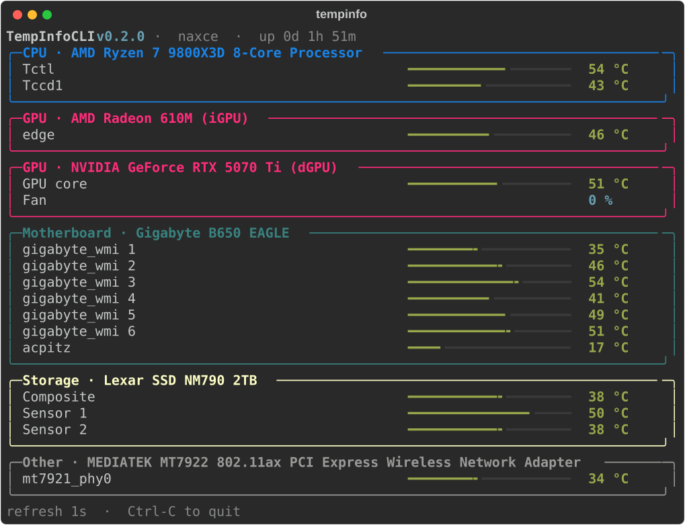

<p align="center">
  
</p>

<h1 align="center">🌡️ TempInfoCLI <sup>v0.1.0</sup></h1>

<p align="center">
  A live, color-coded temperature dashboard for your terminal.<br>
  A CLI port of the Windows TempInfo hardware monitor.
</p>

<p align="center">
  
  
  
  
</p>

<p align="center">
  
  
  
</p>

<p align="center">
  
</p>

<p align="center"><sub>Real readings from a Ryzen + Radeon desktop, captured with <code>tempinfocli</code> v0.1.0.</sub></p>

## ✨ What it does

- 🔄 **Live dashboard** that refreshes in place (default every second). Ctrl-C exits cleanly.
- 🧩 **Grouped panels**: CPU, GPU, Motherboard, Storage, and Fans / Other.
- 🎨 **Color by thermal headroom**: every reading gets a bar and a color for how close it is to its limit.
- 🚫 **Never makes numbers up**: if nothing can be read, it says "no sensors readable".
- 🔒 **Read-only**: it reads sensors and draws them. It never changes anything on your system.

### 🎨 Color thresholds

Drives get hot sooner than CPUs, so each kind of sensor has its own limits:

| Sensor | Cool | Warm | Hot |
|--------|------|------|-----|
| CPU / GPU |  |  |  |
| Motherboard / other |  |  |  |
| Storage (NVMe / SSD) |  |  |  |
| Fans |  | | |

## 🖥️ Platform support

| Platform | Coverage |
|----------|----------|
| 🐧 Linux / NixOS | **Complete**: hwmon via psutil (CPU, motherboard, NVMe/SSD, AMD/Intel GPU, fans), NVIDIA via `nvidia-smi` |
| 🍎 macOS | **Best effort**: `powermetrics`, which needs root. Run `sudo tempinfocli`; otherwise you get "no sensors readable" |
| 🪟 Windows | **Best effort**: ACPI thermal zones via WMI/PowerShell, which usually needs an Administrator terminal. Many machines expose few or none |

## ❄️ Install with Nix flakes (NixOS)

TempInfoCLI is **not in nixpkgs**. The repo ships its own flake instead, so you add it as a flake input.

### Try it without installing

```bash
nix run github:fatumorg/TempInfoCLI
```

### Add it to your NixOS configuration

**1. Add the input** to your system `flake.nix`:

```nix
{
  inputs = {
    nixpkgs.url = "github:nixos/nixpkgs/nixos-unstable";

    tempinfocli = {
      url = "github:fatumorg/TempInfoCLI";
      inputs.nixpkgs.follows = "nixpkgs";
    };
  };
}
```

`inputs.nixpkgs.follows` makes TempInfoCLI build against your system's nixpkgs instead of pulling a second copy.

**2. Pass `inputs` through to your modules** in the same file:

```nix
{
  outputs = { nixpkgs, ... }@inputs: {
    nixosConfigurations.myhost = nixpkgs.lib.nixosSystem {
      system = "x86_64-linux";
      specialArgs = { inherit inputs; };
      modules = [ ./configuration.nix ];
    };
  };
}
```

**3. Install the package.** System-wide, in `configuration.nix`:

```nix
{ pkgs, inputs, ... }:
{
  environment.systemPackages = [
    inputs.tempinfocli.packages.${pkgs.stdenv.hostPlatform.system}.default
  ];
}
```

Or for one user with Home Manager, in `home.nix`. This needs `home-manager.extraSpecialArgs = { inherit inputs; };` in your flake:

```nix
{ pkgs, inputs, ... }:
{
  home.packages = [
    inputs.tempinfocli.packages.${pkgs.stdenv.hostPlatform.system}.default
  ];
}
```

**4. Rebuild:**

```bash
sudo nixos-rebuild switch --flake .#myhost
tempinfocli
```

### Updating and pinning

| Goal | How |
|------|-----|
| Update to the latest commit | `nix flake update tempinfocli`, then rebuild |
| Pin to this release | `url = "github:fatumorg/TempInfoCLI/v0.1.0";` |
| Install without NixOS (any Nix) | `nix profile install github:fatumorg/TempInfoCLI` |
| Hack on it | `nix develop` inside a clone |

### Without flakes

From a clone, `nix-shell` builds the package from `default.nix` and puts `tempinfocli` on your PATH. Or build it standalone with `nix-build && ./result/bin/tempinfocli`.

## 📦 Install from source (any OS)

```bash
git clone https://github.com/fatumorg/TempInfoCLI
cd TempInfoCLI
pip install -e .
tempinfocli
```

## 🚀 Usage

| Command | What it does |
|---------|--------------|
| `tempinfocli` | live dashboard |
| `tempinfocli --once` | print one snapshot and exit |
| `tempinfocli --json` | print sensors as JSON and exit |
| `tempinfocli --interval 2` | refresh every 2s (minimum 0.2) |
| `tempinfocli --no-color` | plain output |
| `tempinfocli --version` | print `tempinfocli 0.1.0` |

When the output is piped or redirected, `tempinfocli` prints one snapshot instead of the live view.

`--json` gives one object per sensor, ready for scripts:

```json
[
  {
    "group": "k10temp",
    "label": "Tctl",
    "value": 57.25,
    "unit": "°C",
    "kind": "cpu"
  },
  {
    "group": "amdgpu",
    "label": "edge",
    "value": 47.0,
    "unit": "°C",
    "kind": "gpu"
  }
]
```

## 🖱️ Desktop icon / shortcut

Install `tempinfocli` first, then:

- 🐧 **Linux**: `./packaging/linux/install-desktop-entry.sh` adds an application-menu entry that opens a terminal running `tempinfocli`.
- 🪟 **Windows**: double-click `packaging\windows\install-shortcut.bat` (or run the `.ps1`) to add Desktop and Start Menu shortcuts that open a console running `tempinfocli`.

## 🧪 Tests

```bash
pip install pytest && pytest
```

The Nix build runs the same suite.

## 📄 License

MIT, see [LICENSE](LICENSE).
